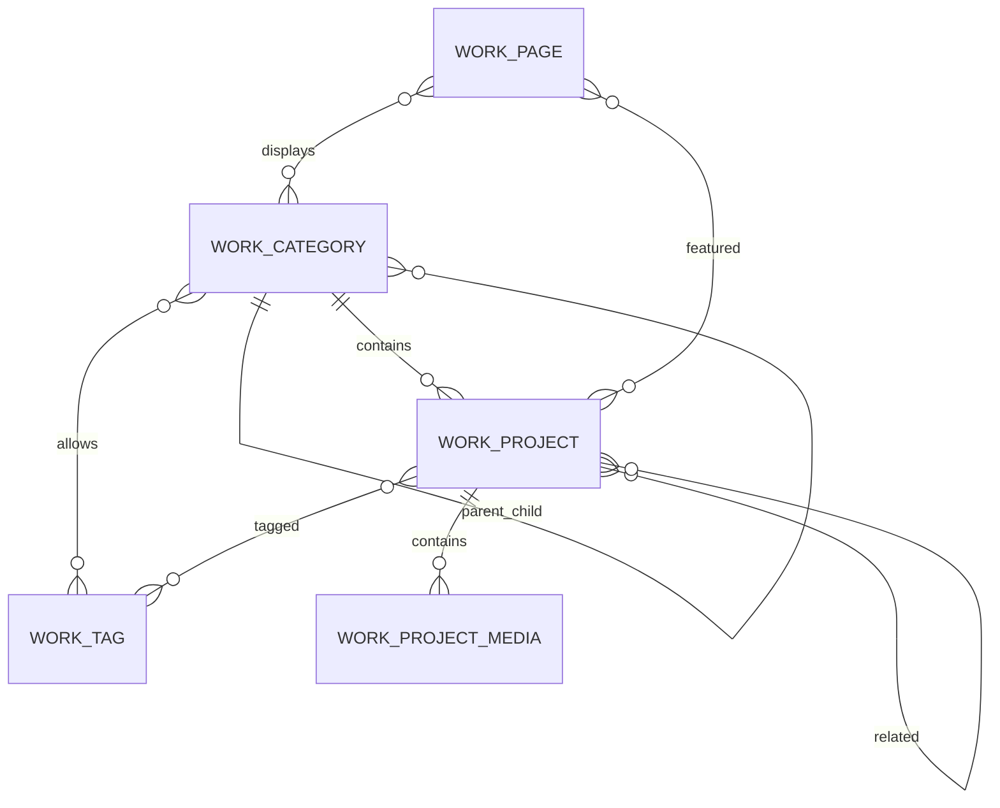

# Work data model (validated schemas in repo)

Schemas live under `cms-strapi-main/src/api/work-*/content-types/*/schema.json`.

## ERD

## Content types

| API UID | Kind | D&P | i18n | Notes |
|---|---|---|---|---|
| `api::work-category.work-category` | collection | yes | yes | self `parent`/`children`; level 1–2 |
| `api::work-tag.work-tag` | collection | yes | yes | m2m categories |
| `api::work-project.work-project` | collection | yes | yes | m2o category; m2m tags; o2m mediaItems |
| `api::work-project-media.work-project-media` | collection | yes | yes | ordered blocks |
| `api::work-page.work-page` | single | yes | yes | featuredProjects / displayCategories |

Does **not** replace `api::category`, `page-seo`, `global`, etc.

## Static video / image URL fields

Locked decision: reference frontend static paths (e.g. `/assets/hero-video/...`) via string fields. Media fields remain optional for future upload.

| Type | String URL fields |
|---|---|
| work-category | `coverUrl` |
| work-project | `coverUrl`, `thumbnailUrl`, `heroMediaUrl`, `videoUrl`, `posterUrl`, `previewVideoUrl`, `homePreviewVideoUrl` |
| work-project-media | `imageUrl`, `videoUrl`, `posterUrl` |

## Migration helper

`legacyId` (unique, non-localized) on category/tag/project/media for idempotent Phase 4 import. Hash routing can keep using static numeric ids via `legacyId`.

## Server rules (Phase 2 — not enforced yet)

1. level=2 requires parent level=1; level=1 forbids parent  
2. project.category must be active level=2  
3. tag.categories should be level=2 only  
4. blockType must match filled media/url fields  
5. embedUrl domain allowlist (default: disable embed in public API)  
6. Soft-disable (`isActive`) before hard delete when children/projects exist  
